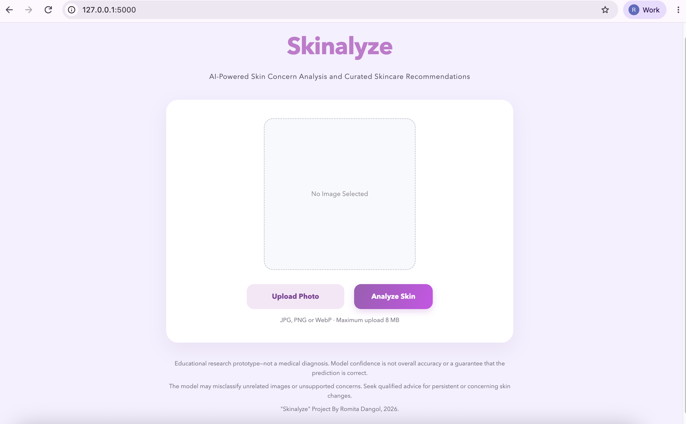
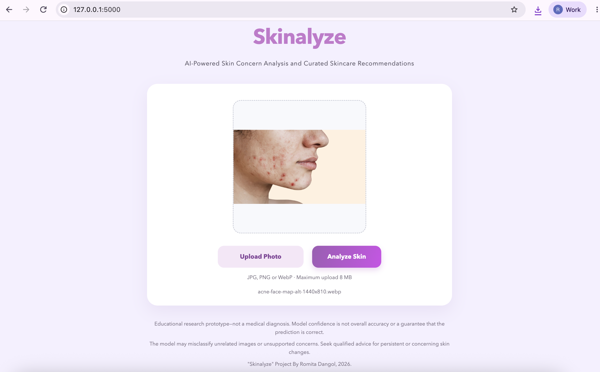
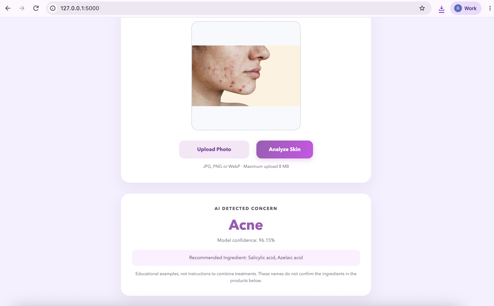
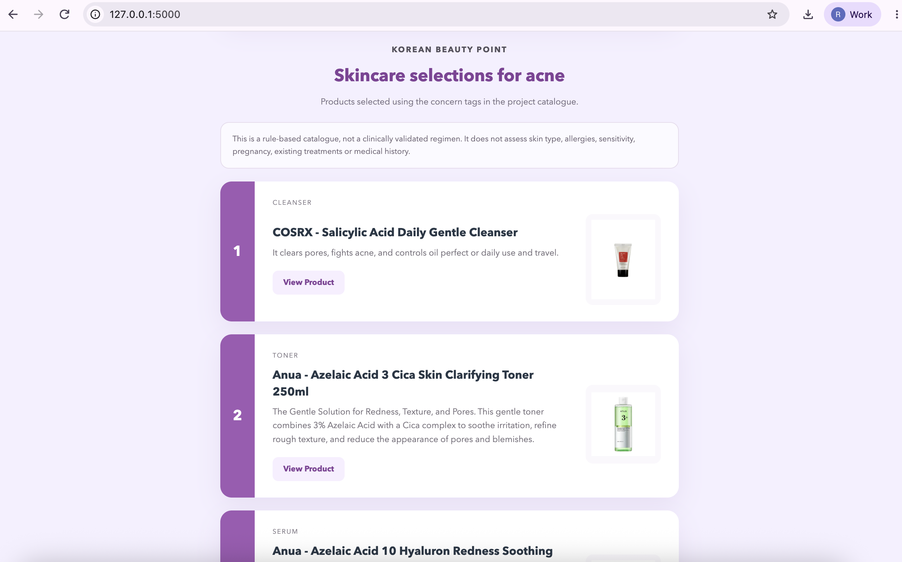
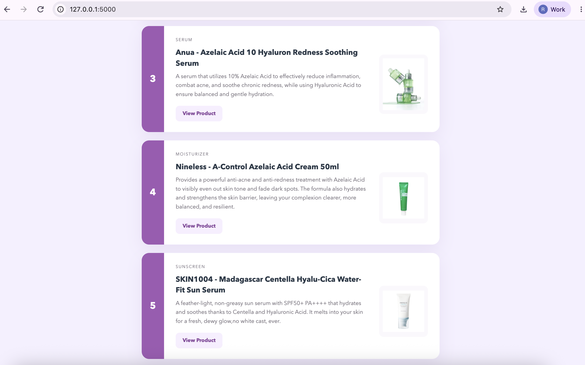
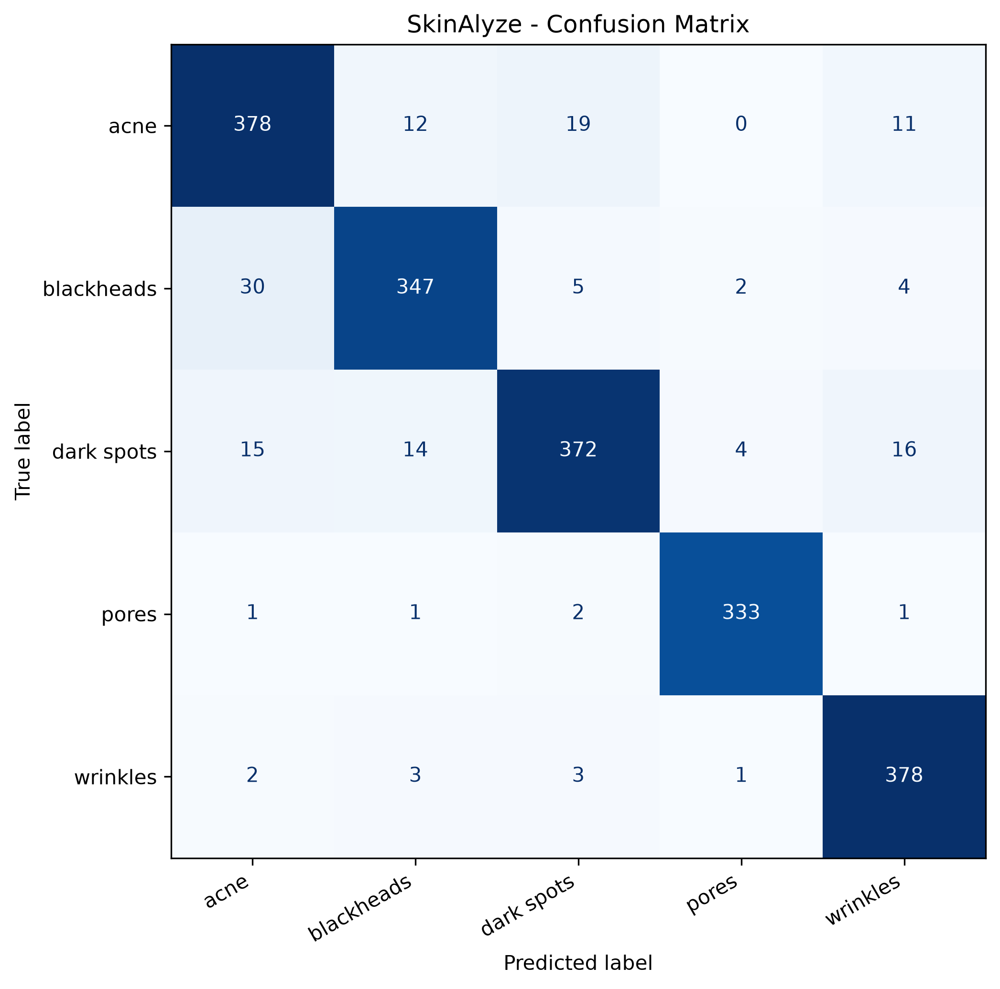
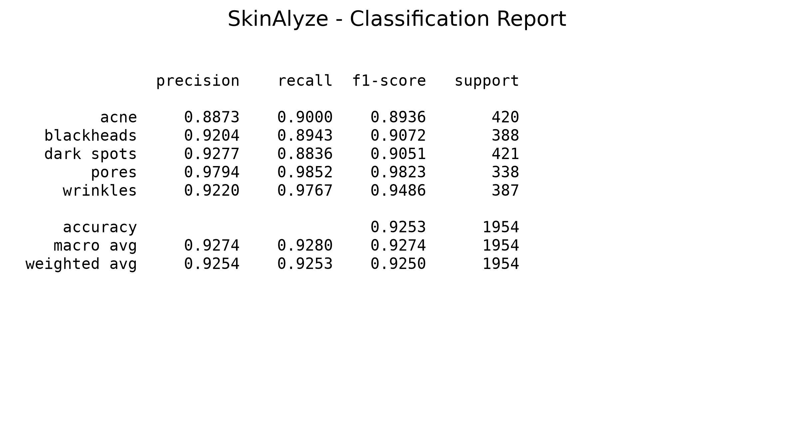

# Skinalyze
### AI-Powered Skin Analysis & Personalized Skincare Recommendation System

> An AI-powered web application combining deep learning, computer vision, and personalized skincare recommendations to make skincare product discovery more informed and accessible.

**Developer:** Romita Dangol  
**Academic Institution:** Presidential Graduate School, affiliated with Westcliff University  
**Course:** CAP 490 — Capstone Project  
**Industry Collaboration:** Korean Beauty Point, Nepal  
**Year:** 2026

---

## Project Overview

**Skinalyze** is an AI-powered skin concern classification and personalized skincare recommendation system developed as an academic capstone project.

The application allows users to upload a skin image, receive an AI-generated prediction of a visible skin concern, and explore relevant skincare ingredients and product recommendations.

The project addresses a practical challenge within Nepal's skincare market: consumers have access to an increasing variety of products but often lack guidance when selecting products appropriate for their concerns.

By integrating an image-classification model with a Flask web application and a rule-based recommendation engine, SkinAlyze explores how artificial intelligence can connect technical image analysis with accessible skincare education and e-commerce product discovery.

The project was developed with academic approval and industry involvement from **Korean Beauty Point**, Nepal's original K-beauty store and official partner of 10+ K-beauty brands.

---

## The Problem

Consumers frequently rely on social media recommendations, influencer trends, or trial-and-error purchases when choosing skincare products.

Without sufficient knowledge of ingredients or their individual skin concerns, choosing suitable products can become confusing.

Skinalyze was developed to explore an accessible solution that:

- Identifies patterns associated with common skin concerns using computer vision.
- Helps users understand ingredients commonly associated with those concerns.
- Connects users with relevant skincare product recommendations.
- Demonstrates how machine learning can support consumer education and product discovery.

The application is intended as an educational decision-support prototype rather than a medical diagnostic tool.

---

## Key Features

| Feature | Description |
|---|---|
| AI Skin Analysis | Analyzes uploaded images using a trained image-classification model |
| MobileNetV2 | Uses a convolutional neural network architecture for image classification |
| Five-Class Classification | Predicts acne, blackheads, dark spots, pores, or wrinkles |
| Confidence Score | Displays prediction confidence alongside the model output |
| Ingredient Education | Provides relevant skincare ingredient information |
| Product Recommendations | Connects predicted concerns with skincare product suggestions |
| Product Links | Links recommendations to corresponding e-commerce pages |
| Web Application | Provides an interactive browser-based interface |

---

## Application Preview

The screenshots below demonstrate the user experience from the application homepage through skin analysis and skincare product discovery.

### 1. Skinalyze Homepage

The homepage introduces the application's AI-powered skincare analysis functionality.

### 2. Upload Skin Image

Users submit an image showing a visible skin concern through the web interface.

### 3. AI Skin Analysis

The trained model processes the submitted image and predicts one of the five supported skin concern categories.

### 4. Personalized Skincare Recommendations

Following classification, the system provides educational ingredient information and related skincare product recommendations.

---

## Supported Skin Concern Categories

The image-classification system focuses on five categories:

| Category | Description |
|---|---|
| Acne | Visible acne-related skin concerns |
| Blackheads | Visible comedonal skin concerns |
| Dark Spots | Areas of visible pigmentation |
| Pores | Visible or enlarged pores |
| Wrinkles | Visible fine lines and wrinkles |

These classifications reflect patterns learned from the training dataset and should not be interpreted as clinical diagnoses.

---

## Technology Stack

| Component | Technology |
|---|---|
| Programming Language | Python |
| Deep Learning | TensorFlow / Keras |
| Model Architecture | MobileNetV2 |
| Machine Learning | CNN-based Image Classification |
| Evaluation | Scikit-learn |
| Visualization | Matplotlib |
| Backend | Flask |
| Frontend | HTML, CSS, JavaScript |
| Data and Configuration | JSON |
| Version Control | Git and GitHub |
| Development Environment | Visual Studio Code |

---

## System Architecture

Skinalyze follows a modular client-server architecture with three primary components.

### Frontend

The browser-based interface provides image upload, result visualization, and access to skincare recommendations.

### Backend

The Python and Flask backend handles application requests, coordinates image processing and model inference, and returns classification and recommendation results.

### Machine Learning and Recommendation Layer

The trained MobileNetV2 model classifies skin images, while the recommendation engine maps predicted categories to relevant ingredients and skincare products.

### Application Workflow

~~~text
          User Opens SkinAlyze
                   |
                   v
           Upload Skin Image
                   |
                   v
            Image Validation
                   |
                   v
           Image Preprocessing
                   |
                   v
        MobileNetV2 Classification
                   |
                   v
        Predicted Skin Concern
          + Confidence Score
                   |
                   v
       Rule-Based Recommendation
                   |
                   v
        Ingredient Information
          + Product Suggestions
                   |
                   v
          Results Displayed
~~~

---

## Dataset Overview

The Skinalyze dataset contains **9,770 images** across five skin concern categories, used to develop and evaluate the MobileNetV2 image classification model.

### Dataset Distribution

| Skin Concern | Number of Images | Percentage |
|---|---:|---:|
| Acne | 2,060 | 21.08% |
| Blackheads | 1,970 | 20.16% |
| Dark Spots | 2,126 | 21.76% |
| Pores | 1,632 | 16.70% |
| Wrinkles | 1,982 | 20.29% |
| **Total** | **9,770** | **100%** |

### Data Splitting

The evaluation script uses an **80:20 training-validation split** with a fixed random seed of 42.

- **Training portion:** 7,816 images
- **Validation portion:** 1,954 images

The dataset shows a relatively balanced distribution, although the pores category contains fewer images than the other classes.

> **Note:** The dataset is excluded from this GitHub repository because of its size. The 80:20 partition describes the evaluation configuration; the training script should be checked to confirm that it uses the same split.

## Machine Learning Development

Skinalyze uses a MobileNetV2-based image-classification model as part of its deep learning pipeline.

The capstone development process involved collecting and organizing skin images, preparing the dataset, training the classification model, evaluating its performance, and integrating the model with a web application.

The academic report documents a dataset containing more than **9,000 images** across five skin concern categories.

### Development Workflow

1. Dataset collection and organization
2. Image preprocessing and preparation
3. Model training using TensorFlow/Keras
4. Classification evaluation using Scikit-learn
5. Model integration with the Flask backend
6. Ingredient and product recommendation mapping
7. Frontend development and application testing

---

## Model Evaluation & Performance

The SkinAlyze MobileNetV2 model was evaluated using a validation subset of **1,954 images** across five skin concern categories.

### Overall Evaluation Metrics

| Metric | Result |
|---|---:|
| **Validation Accuracy** | **92.53%** |
| Macro Precision | 92.74% |
| Macro Recall | 92.80% |
| Macro F1-Score | 92.74% |
| Weighted Precision | 92.54% |
| Weighted Recall | 92.53% |
| Weighted F1-Score | 92.50% |
| Validation Images | 1,954 |
| Correct Classifications | 1,808 |

### Confusion Matrix

The confusion matrix illustrates the distribution of correct and incorrect predictions across the five categories.

Most predictions fall along the diagonal, indicating that the model correctly classified the majority of validation images.

### Classification Report

The classification report summarizes precision, recall, F1-score, and sample support for each class.

### Class-Wise Performance

| Skin Concern | Precision | Recall | F1-Score | Support |
|---|---:|---:|---:|---:|
| Acne | 88.73% | 90.00% | 89.36% | 420 |
| Blackheads | 92.04% | 89.43% | 90.72% | 388 |
| Dark Spots | 92.77% | 88.36% | 90.51% | 421 |
| Pores | 97.94% | 98.52% | 98.23% | 338 |
| Wrinkles | 92.20% | 97.67% | 94.86% | 387 |

### Performance Interpretation

The model demonstrated its strongest performance when classifying **pores**, achieving an F1-score of 98.23%.

Wrinkles also showed strong classification performance, with an F1-score of 94.86%.

Comparatively, acne and dark spots achieved lower F1-scores. The confusion matrix indicates some overlap between visually related categories, highlighting areas for future model refinement.

**Evaluation note:** These metrics were obtained from an image validation subset. They do not establish clinical diagnostic accuracy or independently verified performance on real-world user populations. Further evaluation should verify training-validation separation, dataset diversity, and performance on unseen external images.

---

## Project Structure

~~~text
Skinalyze/
│
├── app/
│   ├── static/
│   │   └── style.css
│   ├── templates/
│   │   └── index.html
│   └── app.py
│
├── models/
│   └── class_names.json
│
├── reports/
│   └── figures/
│       ├── classification_report.png
│       ├── classification_report.txt
│       ├── confusion_matrix.png
│       ├── evaluation_report.txt
│       └── screenshots/
│           ├── homepage.png
│           ├── uploadphoto.png
│           ├── analyzeskin.png
│           ├── productrecommendation1.png
│           └── productrecommendation2.png
│
├── src/
│   ├── train_model.py
│   ├── evaluate_model.py
│   └── predict.py
│
├── products.json
├── requirements.txt
├── .gitignore
└── README.md
~~~

The structure highlights the main project files. Trained model binaries, datasets, and local virtual environments are excluded from version control.

---

## Installation and Setup

### Prerequisites

- Python 3
- Git
- pip
- Required Python dependencies
- Compatible trained MobileNetV2 model weights

### 1. Clone the Repository

~~~bash
git clone https://github.com/romitadangol/Skinalyze.git
cd Skinalyze
~~~

### 2. Create a Virtual Environment

**macOS / Linux**

~~~bash
python3 -m venv .venv
source .venv/bin/activate
~~~

**Windows**

~~~bash
python -m venv .venv
.venv\Scripts\activate
~~~

### 3. Install Dependencies

~~~bash
pip install -r requirements.txt
~~~

### 4. Configure the Model

The trained model binaries and original dataset are not included in this repository.

To run classification, obtain compatible trained model weights and place them in the location expected by the Flask application.

For the evaluation script, the expected model file is:

~~~text
models/skinalyze_mobilenet_best.keras
~~~

### 5. Run the Web Application

~~~bash
python app/app.py
~~~

Open the local address displayed by Flask in your terminal.

### 6. Run Model Evaluation

With the dataset and trained model available locally:

~~~bash
python src/evaluate_model.py
~~~

The evaluation script generates the classification report and confusion matrix under:

~~~text
reports/figures/
~~~

**Note:** Model weights and the evaluation dataset are required to reproduce the evaluation. They are not distributed through this repository.

---

## Industry Collaboration

### Korean Beauty Point — Nepal

Skinalyze was developed for **CAP 490: Capstone Project** with academic project approval and industry involvement from Korean Beauty Point, Nepal's original K-beauty store and official partner of 10+ K-beauty brands.

The project explores a practical business challenge: connecting consumers with skincare products relevant to their individual concerns while improving awareness of skincare ingredients.

The application's recommendation system incorporates product information and e-commerce links associated with Korean Beauty Point's catalog.

The industry context helped shape the project's focus on user experience, accessible guidance, recommendation logic, and the application of machine learning to real-world retail challenges.

This was an academic research and development collaboration and does not imply commercial deployment, medical endorsement, or independent clinical validation.

---

## Academic Background

| Detail | Information |
|---|---|
| Project Title | Skinalyze |
| Course | CAP 490: Capstone Project |
| Institution | Presidential Graduate School |
| University Affiliation | Westcliff University |
| Specialization | Artificial Intelligence & Machine Learning |
| Industry Organization | Korean Beauty Point, Nepal |
| Developer | Romita Dangol |
| Year | 2026 |

The capstone involved project research, industry approval, system architecture, machine learning development, application implementation, evaluation, and business feasibility analysis.

---

## Limitations

Skinalyze is an academic prototype and has several limitations:

- The classification model supports only five predefined skin concern categories.
- Predictions depend on image quality, lighting, and the characteristics of the training dataset.
- The dataset may not adequately represent all skin tones and demographic groups.
- Validation accuracy does not necessarily reflect performance on entirely new populations or imaging conditions.
- The application has not undergone clinical validation.
- Additional privacy, security, and data handling safeguards would be needed before production deployment.

---

## Future Improvements

Potential future developments include:

- Expanding the dataset across diverse skin tones and conditions
- Evaluating model performance on an independent external test set
- Improving classification accuracy and model generalization
- Exploring additional CNN and transfer-learning architectures
- Introducing real-time camera-based image analysis
- Strengthening image privacy and secure data handling
- Extending the skincare recommendation system
- Improving automated testing and deployment readiness

---

## Developer

**Romita Dangol**

Bachelor of Science in Information Technology  
Specialization: Artificial Intelligence & Machine Learning

Presidential Graduate School | Westcliff University

**GitHub:** [romitadangol](https://github.com/romitadangol)

---

## Disclaimer

Skinalyze is developed for academic research, machine learning experimentation, and general skincare education.

The application is not a medical device and does not provide professional dermatological diagnoses or medical treatment recommendations. Users should consult qualified healthcare professionals for medical concerns.

---

  <strong>Skinalyze — AI-Powered Skin Analysis & Smarter Skincare Discovery</strong>

  Developed by Romita Dangol | 2026

